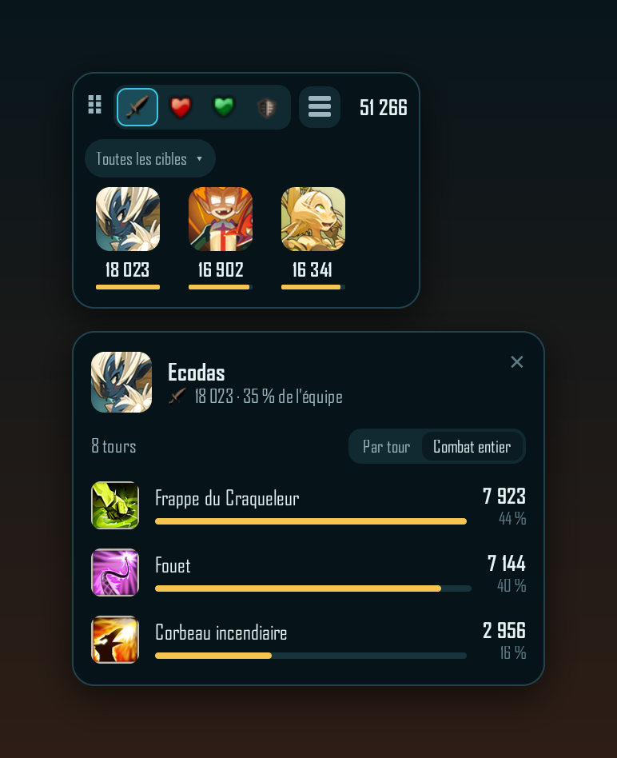
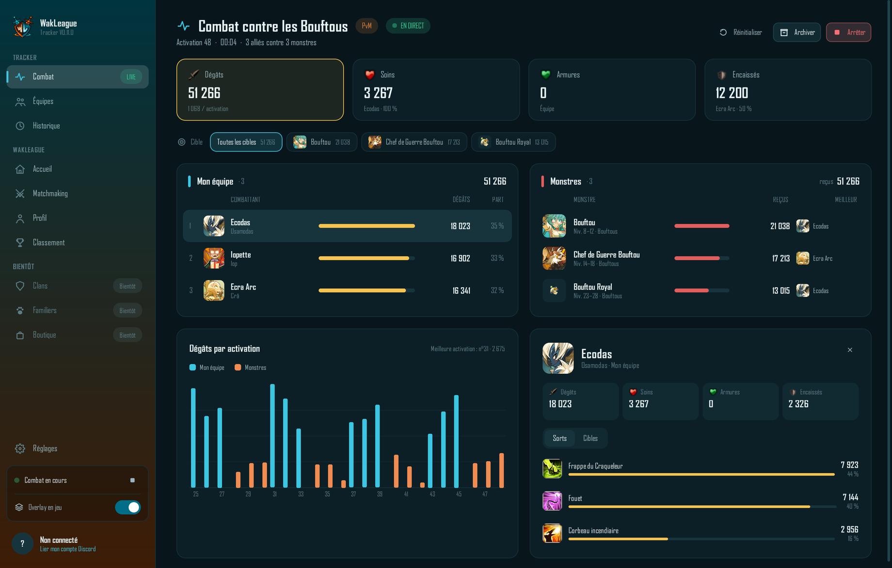

# WakLeague Tracker

**Tes dégâts, soins et armures en direct, par-dessus Wakfu.**

WakLeague Tracker lit le journal de combat de ton client Wakfu et affiche, pendant le combat, ce que chaque
personnage de ton équipe apporte vraiment : dégâts, soins, armures données et dégâts encaissés, invocations comprises.

<p align="center">
  
</p>

### ⬇️ [Télécharger la dernière version](https://github.com/Utojiko/WakLeague-Tracker-Releases/releases/latest)

- **Windows** : `WakLeague-Tracker-Windows.exe` (un seul fichier, rien à installer)
- **macOS** : `WakLeague-Tracker-macOS.zip`

> Ne télécharge pas les fichiers « Source code (zip / tar.gz) » : GitHub les ajoute automatiquement à chaque
> version, ils ne contiennent que cette page.

---

## L'overlay en jeu

Un petit panneau translucide, toujours au premier plan, au-dessus de la fenêtre de Wakfu :

- **4 statistiques** au choix : dégâts infligés, soins, armures données, dégâts encaissés.
- **Chaque personnage de ton équipe** avec son portrait, son total et sa part de l'équipe.
- **Filtre par cible** en PvM : tous les monstres, ou un seul.
- **Les clics le traversent** : tu continues de jouer normalement, seuls ses boutons réagissent.
- **Fiche joueur** en cliquant sur un portrait : dégâts par sort, tour par tour ou sur tout le combat, et l'ordre
  dans lequel les sorts ont été lancés.
- Disposition **en ligne ou en colonne**, taille de 50 à 150 %, opacité réglable, déplaçable où tu veux.

## Le détail de chaque combat

<p align="center">
  
</p>

- **Totaux de l'équipe** et répartition par combattant, en PvM comme en PvP.
- **Monstres** : dégâts reçus par chacun et qui les a le plus frappés.
- **Dégâts par activation** de ton équipe et des monstres, tout au long du combat.
- **Invocations rattachées à leur invocateur**, et effets différés (poisons…) attribués à leur lanceur.
- **Multi-comptes** : les lignes en double quand plusieurs clients tournent sur le même PC sont fusionnées.
- **Historique** de tes derniers combats, archivés automatiquement, avec des favoris protégés.

L'application sert aussi de client pour la ligue PvP **WakLeague** (matchmaking, profil, classements) si tu lies ton
compte Discord. Tout ce qui est présenté plus haut fonctionne sans compte.

---

## « Windows a protégé votre ordinateur » : pourquoi, et comment lancer le Tracker

Au premier lancement, Windows affiche cet avertissement bleu :

<p align="center">
  
</p>

**Pourquoi ?** SmartScreen bloque par défaut toute application qu'il ne connaît pas encore. Il lui faut deux
choses pour lui faire confiance :

- une **signature numérique** de l'éditeur (un certificat payant, renouvelé chaque année), d'où la mention
  « Éditeur inconnu » ;
- une **réputation**, construite au fil des téléchargements.

WakLeague Tracker est un projet communautaire récent et non signé : il n'a encore ni l'une ni l'autre. Le message
ne veut pas dire qu'un virus a été trouvé, seulement que Windows ne connaît pas ce programme.

**Pour lancer le Tracker :**

1. Clique sur **Informations complémentaires**.
2. Clique sur **Exécuter quand même**.

<p align="center">
  
</p>

Windows ne le redemande plus pour ce fichier. **Les mises à jour suivantes ne déclenchent pas cet avertissement** :
le Tracker les installe lui-même.

> 🔒 Télécharge le Tracker **uniquement depuis cette page**. Une copie trouvée ailleurs a pu être modifiée.

### Sur macOS

macOS bloque aussi les applications non signées. Après avoir décompressé le zip :

1. Glisse **WakLeague - Tracker** dans le dossier **Applications** (indispensable pour les mises à jour automatiques).
2. Ouvre-le une première fois : macOS refuse.
3. Va dans **Réglages Système › Confidentialité et sécurité**, puis clique sur **Ouvrir quand même** en face de
   WakLeague - Tracker.

---

## Premier lancement

Le Tracker te demande où se trouve le fichier `wakfu.log`, le journal que Wakfu écrit pendant tes combats.
Avec le launcher Ankama, il se trouve ici sous Windows :

```
%APPDATA%\zaap\gamesLogs\wakfu\logs\wakfu.log
```

Colle ce chemin dans la barre d'adresse de l'explorateur, ou utilise **Parcourir…** dans le Tracker.

- Le client Wakfu doit être **en français** : le Tracker lit les messages de combat tels que le jeu les écrit.
- Le Tracker ne fait que **lire** ce journal, il ne touche pas au jeu. Tes combats restent sur ton PC : seul le
  résultat d'un match WakLeague est déclaré à la ligue.
- Tes réglages et ton historique sont rangés dans `%APPDATA%\WakLeague - Tracker`
  (macOS : `~/Library/Application Support/WakLeague - Tracker`).

## Mises à jour

Le Tracker vérifie au démarrage s'il existe une nouvelle version. Si oui, un encart **Mise à jour disponible**
apparaît : clique sur **Installer**, puis sur **Redémarrer**. Pas besoin de supprimer ni de réinstaller quoi que ce
soit, et tes réglages sont conservés.

Le redémarrage attend la fin de ton combat, de ta file ou de ton match WakLeague. Si tu fermes simplement le Tracker,
la mise à jour s'installe pour le lancement suivant.
