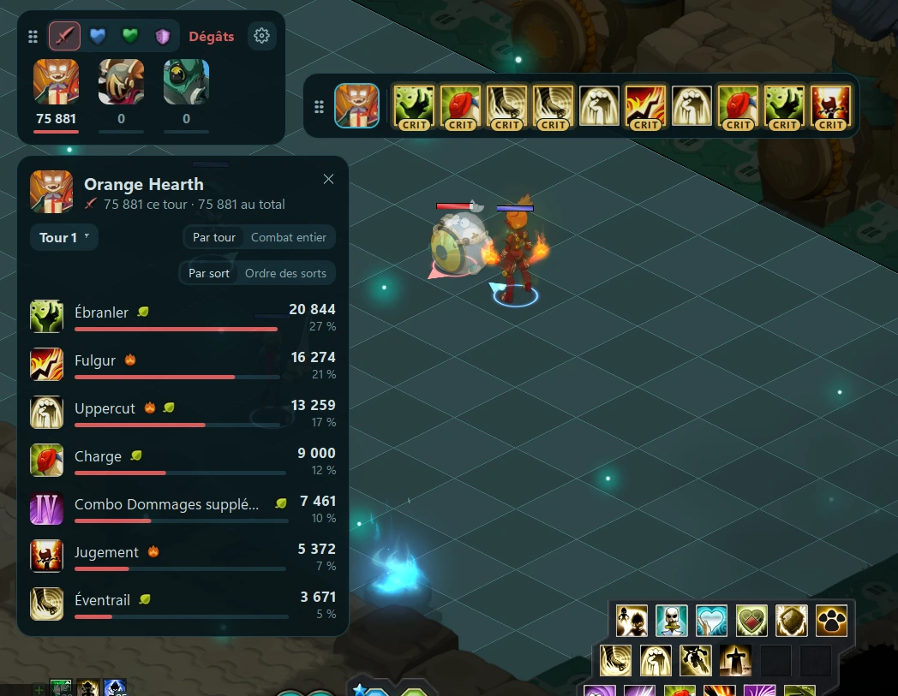
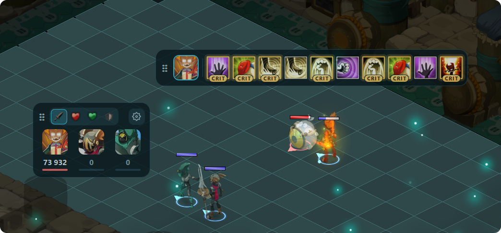
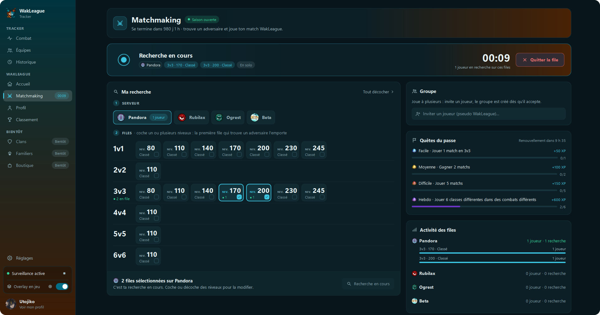
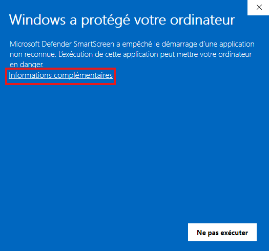
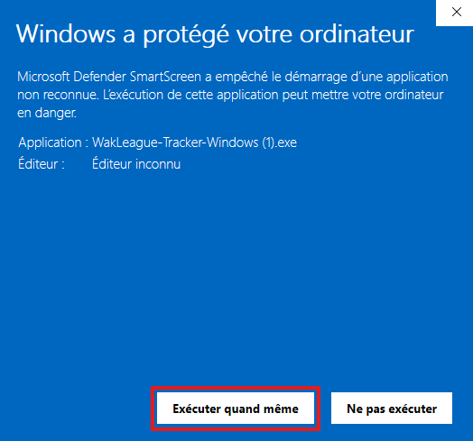

# WakLeague Tracker

**Le tracker de combat pour Wakfu, en PvM comme en PvP : dégâts, soins, armures et sorts, en direct, tour par tour.**

WakLeague Tracker lit le journal de combat de ton client Wakfu et te montre, pendant le combat, ce que chaque
personnage de ton équipe apporte vraiment : dégâts infligés, soins, armures données et dégâts encaissés, tour par
tour, invocations comprises. Donjon, boss ou combat entre joueurs : il reconnaît tout seul le type de combat.

Il te sert de trois façons :

- **Un overlay en jeu**, discret et toujours au-dessus de Wakfu, pour garder un œil sur l'essentiel pendant que tu
  joues : qui fait combien de dégâts, de soins, d'armures, et les sorts lancés à chaque tour.
- **Une application complète** pour aller dans le détail, pendant ou après le combat : sort par sort, cible par
  cible, tour par tour, avec l'historique de tous tes combats.
- **Le client de la ligue PvP WakLeague**, directement dans l'application : recherche de match seul ou en groupe,
  déclaration des personnages, résultat déclaré automatiquement, profil, ELO, classements et quêtes.

<p align="center">
  
</p>

<p align="center"><em>L'overlay est entièrement paramétrable : tu choisis chaque partie affichée (statistiques,
fiche joueur, sorts du tour), sa place, sa taille et son opacité.</em></p>

### ⬇️ [Télécharger la dernière version](https://github.com/Utojiko/WakLeague-Tracker-Releases/releases/latest)

- **Windows** : `WakLeague-Tracker-Windows.exe` (un seul fichier, rien à installer)
- **macOS** : `WakLeague-Tracker-macOS.zip`

> Ne télécharge pas les fichiers « Source code (zip / tar.gz) » : GitHub les ajoute automatiquement à chaque
> version, ils ne contiennent que cette page.

**En bref :**

- ⚔️ **PvM et PvP** : dégâts par monstre et par cible en donjon, camps et adversaires en PvP.
- 📊 **Statistiques en direct** par-dessus le jeu : dégâts, soins, armures, encaissés, pour chaque allié.
- ⏱️ **Tour par tour** : dégâts de chaque tour, meilleur tour, ordre des sorts lancés.
- ✨ **Sorts du tour** : les sorts de ton allié s'affichent à l'écran dès qu'il les lance.
- 🗂️ **Historique** de tous tes combats, avec le déroulé complet.
- 🏆 **WakLeague** : matchmaking, groupes, profil et classements de la ligue PvP, sans quitter le jeu.

Tout le tracker fonctionne **sans compte**. Le compte Discord ne sert qu'à la partie WakLeague.

---

## L'overlay : l'essentiel en jeu

L'overlay est **entièrement paramétrable** : chaque partie (le panneau de statistiques, la fiche joueur, la barre
des sorts du tour) s'affiche ou se masque à ton choix et se place où tu veux, indépendamment des autres
(Réglages › Overlay).

### L'overlay de statistiques

Un petit panneau translucide, toujours au premier plan, au-dessus de la fenêtre de Wakfu :

- **4 statistiques** au choix : dégâts infligés, soins, armures données, dégâts encaissés.
- **Chaque personnage de ton équipe** avec son portrait, son total et sa part de l'équipe, mis à jour à chaque coup.
- **Filtre par cible** en PvM : tous les monstres, ou un seul.
- **Les clics le traversent** : tu continues de jouer normalement, seuls ses boutons réagissent.
- **Fiche joueur** en cliquant sur un portrait : dégâts par sort, **tour par tour** ou sur tout le combat, et
  l'ordre dans lequel les sorts ont été lancés. Elle s'ouvre sur le dernier tour et suit les tours suivants.
- Disposition **en ligne ou en colonne**, taille de 50 à 150 %, opacité réglable, déplaçable où tu veux.

### Les sorts du tour, en direct

<p align="center">
  
</p>

Une barre à part, au-dessus de la barre de sorts de Wakfu : **dès qu'un allié lance un sort, son icône
apparaît**, dans l'ordre où il les joue, avec le portrait du personnage qui joue. Les **coups critiques** sont
marqués et les sorts lancés par ses invocations sont repérés. La barre se vide à la fin du tour et reste invisible pendant les tours adverses :
tu vois ce que fait ton équipe, jamais ce que font les adversaires.

Idéal pour suivre un allié, revoir son enchaînement ou montrer ton tour en stream. Elle s'active et se place
indépendamment de l'overlay (Réglages › Overlay).

---

## En PvM comme en PvP

Le Tracker détecte tout seul le type de combat : **PvM** dès que des monstres sont présents, **PvP** sinon.
Chaque mode a ses propres outils.

### ⚔️ En PvM : donjons, boss, farm

- **Tableau des monstres** : nom, niveau et image de chaque monstre, dégâts qu'il a reçus et qui l'a le plus frappé.
- **Filtre par cible** : tous les monstres, ou un seul (le boss, par exemple) pour voir qui a vraiment porté le
  combat sur lui. Le filtre s'applique aussi à l'overlay en jeu.
- **Compagnons** reconnus et comptés dans ton équipe, avec leur portrait.
- Dans l'historique, les **soins et sorts subis par chaque monstre** sont aussi conservés.

### 🛡️ En PvP : défis, interserveur, WakLeague

- **Ton équipe face à l'adversaire** : dégâts infligés et encaissés de chacun de tes alliés en direct, puis dans
  l'historique le bilan de chaque combattant des deux camps.
- **Attribution des camps** : une petite fenêtre te propose de ranger chaque joueur détecté dans ton équipe ou
  chez l'adversaire, puis disparaît. Tu peux corriger les camps à tout moment.
- **KO de chaque combattant** enregistrés dans le déroulé du combat.
- En **match WakLeague**, les camps sont remplis automatiquement à partir du match et le résultat peut être déclaré
  pour toi (voir plus bas).

---

## L'application : le détail de chaque combat

L'overlay montre l'essentiel ; la fenêtre du Tracker montre tout.

<p align="center">
  
</p>

### Pendant le combat

- **Totaux de l'équipe** et classement des combattants pour chaque statistique, en PvM comme en PvP.
- **Dégâts par tour** : un graphique avec, pour chaque tour du combat, ce qu'a fait chaque allié, et le
  meilleur tour mis en avant.
- **Détail d'un combattant** : dégâts par sort et par cible.

### Après le combat : l'historique

Chaque combat est archivé automatiquement, classé par jour, avec des favoris protégés. Pour chacun :

- **Vue d'ensemble** par combattant : dégâts, soins, armures, encaissés, sorts lancés, critiques,
  **meilleur tour**, KO.
- **Fiche d'un combattant** : tableau des sorts, cibles touchées, dégâts et soins reçus, **ordre des sorts à
  chaque tour**.
- **Déroulé tour par tour** de tout le combat : chaque sort, ses effets, ses critiques, chaque KO.
- **Cibles** : qui a touché qui, avec quels sorts.

### Des chiffres justes

- **Invocations rattachées à leur invocateur**, et effets différés (poisons…) attribués à leur lanceur.
- Seuls les soins et armures donnés **à ta propre équipe** sont comptés.
- **Multi-comptes** : les lignes en double quand plusieurs clients tournent sur le même PC sont fusionnées.

---

## WakLeague, la ligue PvP

<p align="center">
  
</p>

Le Tracker est aussi le client officiel de **WakLeague**, la ligue PvP communautaire de Wakfu. Lie ton compte
Discord pour :

- **Chercher un match** : choix du serveur, du format, du niveau et du mode, avec le nombre de joueurs déjà en
  recherche. Une alerte sonore te prévient quand un match est trouvé, même si le Tracker est en arrière-plan.
- **Jouer en groupe** : invite tes coéquipiers, gérez la file ensemble.
- **Déclarer tes personnages** en quelques clics, depuis la liste de ceux que tu joues d'habitude.
- **Résultat automatique** : à la fin du combat, le Tracker reconnaît le camp vainqueur dans le journal et déclare
  le résultat pour toi, seulement quand il en est certain. Sinon, tu le déclares toi-même (victoire ou litige).
- **Profil** : ELO et rang par file, saison, classes les plus jouées, statistiques par classe, titres.
- **Classements** de chaque file, et **quêtes** du jour et de la semaine.
- **Rich Presence Discord** : tes amis voient que tu es en file ou en match.

Pendant un match WakLeague, les équipes sont remplies automatiquement et l'overlay s'affiche tout seul.

---

## « Windows a protégé votre ordinateur » : pourquoi, et comment lancer le Tracker

Au premier lancement, Windows affiche cet avertissement bleu :

<p align="center">
  
</p>

**Pourquoi ?** SmartScreen bloque par défaut toute application qu'il ne connaît pas encore. Il lui faut deux
choses pour lui faire confiance :

- une **signature numérique** de l'éditeur (un certificat payant, renouvelé chaque année), d'où la mention
  « Éditeur inconnu » ;
- une **réputation**, construite au fil des téléchargements.

WakLeague Tracker est un projet communautaire récent et non signé : il n'a encore ni l'une ni l'autre. Le message
ne veut pas dire qu'un virus a été trouvé, seulement que Windows ne connaît pas ce programme.

**Pour lancer le Tracker :**

1. Clique sur **Informations complémentaires**.
2. Clique sur **Exécuter quand même**.

<p align="center">
  
</p>

Windows ne le redemande plus pour ce fichier. **Les mises à jour suivantes ne déclenchent pas cet avertissement** :
le Tracker les installe lui-même.

> 🔒 Télécharge le Tracker **uniquement depuis cette page**. Une copie trouvée ailleurs a pu être modifiée.

### Sur macOS

macOS bloque aussi les applications non signées. Après avoir décompressé le zip :

1. Glisse **WakLeague - Tracker** dans le dossier **Applications** (indispensable pour les mises à jour automatiques).
2. Ouvre-le une première fois : macOS refuse.
3. Va dans **Réglages Système › Confidentialité et sécurité**, puis clique sur **Ouvrir quand même** en face de
   WakLeague - Tracker.

---

## Premier lancement

Le Tracker te demande où se trouve le fichier `wakfu.log`, le journal que Wakfu écrit pendant tes combats.
Avec le launcher Ankama, il se trouve ici sous Windows :

```
%APPDATA%\zaap\gamesLogs\wakfu\logs\wakfu.log
```

Colle ce chemin dans la barre d'adresse de l'explorateur, ou utilise **Parcourir…** dans le Tracker.

- Le client Wakfu doit être **en français** : le Tracker lit les messages de combat tels que le jeu les écrit.
- Le Tracker ne fait que **lire** ce journal, il ne touche pas au jeu. Tes combats restent sur ton PC : seul le
  résultat d'un match WakLeague est déclaré à la ligue.
- Tes réglages et ton historique sont rangés dans `%APPDATA%\WakLeague - Tracker`
  (macOS : `~/Library/Application Support/WakLeague - Tracker`).

## Mises à jour

Le Tracker vérifie au démarrage s'il existe une nouvelle version. Si oui, un encart **Mise à jour disponible**
apparaît : clique sur **Installer**, puis sur **Redémarrer**. Pas besoin de supprimer ni de réinstaller quoi que ce
soit, et tes réglages sont conservés.

Le redémarrage attend la fin de ton combat, de ta file ou de ton match WakLeague. Si tu fermes simplement le Tracker,
la mise à jour s'installe pour le lancement suivant.
